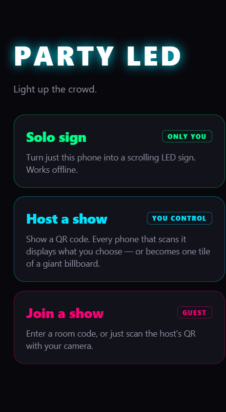
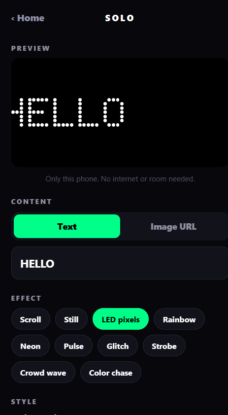
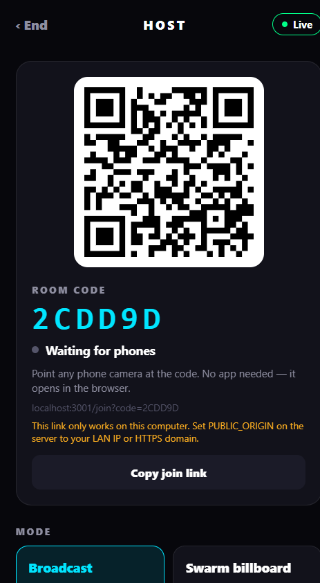
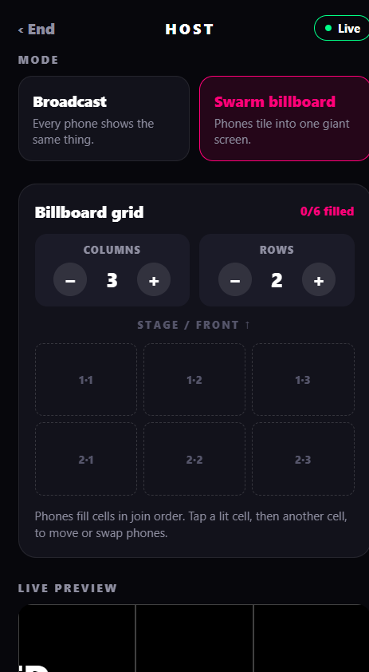

# Party LED

Turn phones into LED signs. Use one phone on its own, or host a show where every phone that scans your QR code displays what you choose — either the same thing on every screen (**Broadcast**) or one tile of a giant billboard (**Swarm**).

Guests don't need to install anything: the QR code opens the web app in the phone's browser, or the native app if it's installed (once app links are configured).

| Home | Solo (LED pixels) | Host QR | Swarm grid |
| --- | --- | --- | --- |
|  |  |  |  |

## Features

- **Solo sign** — offline, only this phone. Settings are remembered; fullscreen locks to landscape.
- **Host a show** — QR code + room code, live preview, Blackout and Start/Stop.
- **Broadcast mode** — every phone shows the same content.
- **Swarm billboard** — phones fill a columns × rows grid in join order; tap cells to move or swap phones. Animations are synced to the server clock.
- **Effects** — Scroll, Still, LED pixels, Rainbow, Neon, Pulse, Glitch, Strobe, Crowd wave, Color chase. Text or image URL, colors, size, speed, brightness.
- Guests reconnect automatically after a dropped connection or page reload.

## Run locally

Requires Node 18+.

```bash
npm install
npm run build:web          # static web export to dist/
npm --prefix server install
node server/index.js       # serves dist/ + WebSocket on http://localhost:3001
```

Open http://localhost:3001.

**Important:** `localhost:3001` serves the last `npm run build:web` output. After UI changes, run `npm run build:web` again (or `npm run serve` to rebuild and start the server), then hard-refresh the browser.

For live-reload while editing, run `npx expo start --web` (port 8081) alongside the server (the web app on :8081 talks to the server on :3001).

### Test with phones on your Wi-Fi

`localhost` QR codes only work on the computer itself. Start the server with your computer's LAN address so the QR points somewhere phones can reach:

```powershell
$env:PUBLIC_ORIGIN="http://192.168.1.50:3001"; node server/index.js
```

Phones and computer must be on the same network. Camera/fullscreen features may require HTTPS on some browsers — see deployment.

## How to use

1. **Host:** tap *Host a show*. Show the QR code to your guests.
2. **Guests:** scan the QR (or open *Join a show* and type the room code), then tap to start.
3. **Host:** choose *Broadcast* or *Swarm billboard*, set the message and effect, then press **Start**. Use **Blackout** to darken every screen instantly.
4. In Swarm mode, set the grid to match how people are standing (row 1 is closest to the stage) and tap cells to rearrange phones.

## Checks

```bash
npx tsc --noEmit
npx expo lint
npm test                   # server protocol tests
```

## Deployment

See [DEPLOYMENT.md](DEPLOYMENT.md). Before going live, replace these placeholders:

- `YOUR_DOMAIN.example` — production domain (`app.json`, server `.well-known` files)
- `APPLE_TEAM_ID` — iOS universal links
- `ANDROID_RELEASE_SHA256` — Android app links

Environment variables: `PUBLIC_ORIGIN` (server, the URL encoded in QR codes), `PORT` (server, default 3001), `EXPO_PUBLIC_SERVER_URL` (native app builds).
